---

## ☸️ Tentang

Saya belajar dengan cara membangun. Fokus saya membuat alat yang benar-benar terpakai, dari antarmuka web sampai aplikasi Android, dan sebagian besar kodenya saya tulis langsung dari HP.

- 🔭 Sedang dikerjakan: **Mahoraga**, aplikasi keuangan mingguan offline
- 🌱 Sedang dipelajari: pipeline build Android otomatis dengan GitHub Actions
- ⚡ Gaya kerja: bangun dulu, rapikan sambil jalan

## 🛠️ Tech Stack

## 📌 Proyek

| Proyek | Deskripsi | Teknologi | Status |
| --- | --- | --- | --- |
| [**Mahoraga**](https://github.com/CrackDoom-dev/Mahoraga) | Aplikasi keuangan mingguan, mobile-first, jalan offline penuh, dengan skor 5 pilar finansial | React, Vite, Tailwind, Capacitor | 🟢 Aktif |

> Proyek lain akan ditambahkan di sini seiring selesai.

## 🧭 Prinsip

- Alat yang sederhana tapi dipakai tiap hari lebih bernilai daripada proyek besar yang tidak selesai
- Data pengguna tetap di perangkat sebisa mungkin
- Otomatiskan hal yang membosankan, termasuk build dan rilis

---

Terima kasih sudah mampir ☕

